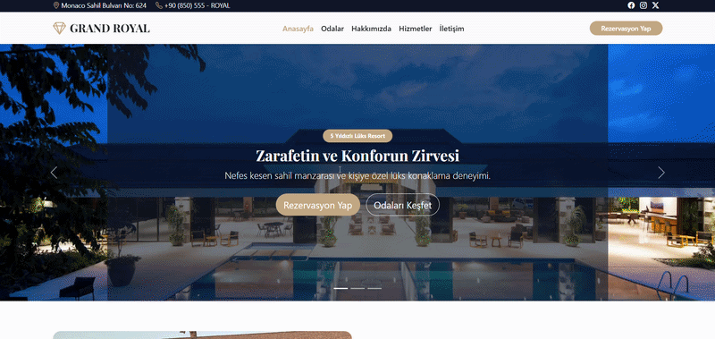

# 🏨 Grand Royal Hotel

A luxury hotel website featuring elegant design, premium room listings, hotel services, guest reviews, and a responsive user interface. Built with HTML5, CSS3, and Bootstrap 5.

## ✨ Features

- **Responsive Navigation Bar** — Mobile-friendly navigation with a collapsible menu.
- **Hero Image Carousel** — Three promotional slides with captions and call-to-action buttons.
- **About Section** — Hotel introduction and highlighted amenities.
- **Featured Rooms** — Room cards with images, descriptions, and nightly prices.
- **Rooms & Suites Page** — Dedicated room listings with amenities and pricing.
- **Room Filter Interface** — Form controls for room type, price range, and guest count.
- **Special Offer Alert** — Dismissible seasonal discount notification.
- **Hotel Services** — Spa, restaurant, swimming pool, gym, VIP transfer, and conference facilities.
- **Guest Reviews** — Testimonial cards with star ratings.
- **Hotel Facilities Accordion** — Expandable information about selected amenities.
- **Breadcrumb Navigation** — Helps users understand their location on the rooms page.
- **Pagination Interface** — Visual page navigation for room listings.
- **Contact Information** — Hotel address, phone number, and email address.
- **Custom Hover Effects** — Animated room cards and interactive buttons.
- **Responsive Layout** — Bootstrap grid system for mobile, tablet, and desktop screens.
- **Bootstrap Icons** — Icons for hotel features, contact details, and amenities.
- **Google Fonts** — Playfair Display and Plus Jakarta Sans typography.

---

## 🛠️ Technologies Used

| Technology | Purpose |
|---|---|
| HTML5 | Semantic webpage structure |
| CSS3 | Custom styling, animations, and visual effects |
| Bootstrap 5.3.8 | Responsive layout and UI components |
| Bootstrap Icons 1.13.1 | Interface and service icons |
| JavaScript (Bootstrap Bundle) | Carousel, navbar, accordion, and dismissible alert behavior |
| Google Fonts | Custom typography |
| CSS Variables | Reusable color definitions |
| CSS Transitions & Transforms | Hover effects and animations |
| CSS Keyframes | Popup animation |

---

# IMAGES

1. https://images.unsplash.com/photo-1542314831-068cd1dbfeeb?auto=format&fit=crop&w=1600&q=80
2. https://images.unsplash.com/photo-1582719478250-c89cae4dc85b?auto=format&fit=crop&w=1600&q=80
3. https://images.unsplash.com/photo-1517248135467-4c7edcad34c4?auto=format&fit=crop&w=1600&q=80
4. https://images.unsplash.com/photo-1566073771259-6a8506099945?auto=format&fit=crop&w=800&q=80
5. https://images.unsplash.com/photo-1618773928121-c32242e63f39?auto=format&fit=crop&w=600&q=80
6. https://images.unsplash.com/photo-1582719478250-c89cae4dc85b?auto=format&fit=crop&w=600&q=80
7. https://images.unsplash.com/photo-1591088398332-8a7791972843?auto=format&fit=crop&w=600&q=80

---

## 🔍 Preview

---

## 📞 Contact  

📩 **Email:** [saadetnajaf@gmail.com](mailto:saadetnajaf@gmail.com)  
📷 **Instagram:** [@saadet_najaf](https://www.instagram.com/saadet_najaf)  
💼 **LinkedIn:** [Saadet Najaf](https://www.linkedin.com/in/saadetnajaf/)
